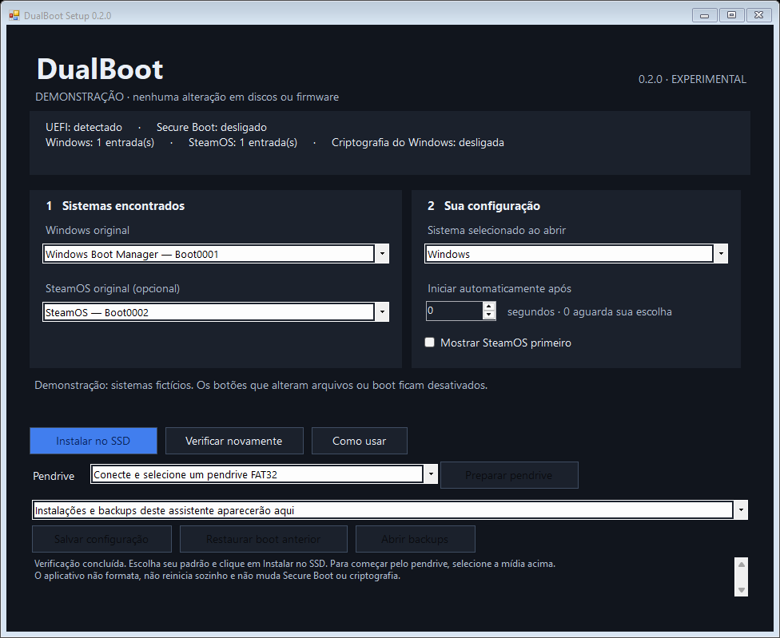
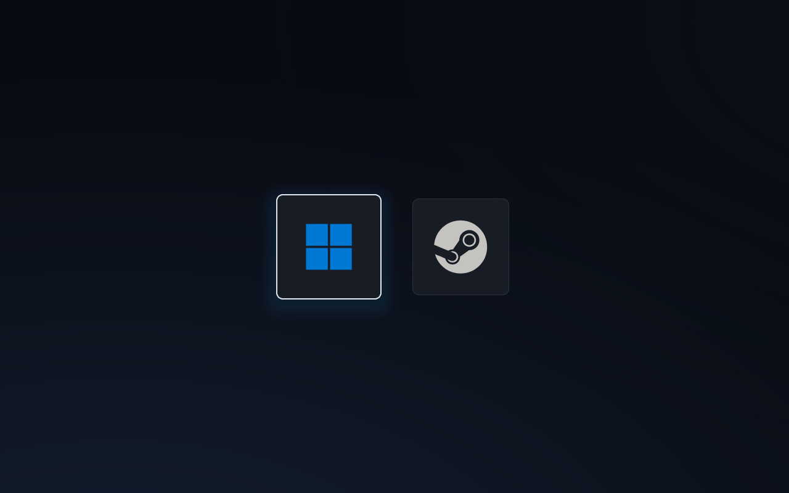

# DualBoot UEFI

Escolha **Windows ou SteamOS antes de o sistema iniciar**, usando teclado ou um controle compatível. Gerenciador UEFI x86-64 escrito em C, com dois cartões visuais, tema por arquivos e diagnóstico USB integrado.

**Instalador 0.2.0 experimental, com gerenciador EFI 0.1.0.** O gerenciador foi testado fisicamente em um PC com Flydigi Direwolf 4 no modo compatível com Xbox 360 (`045E:028E`, interface `FF/5D/01`). Outros PCs, controles, receptores, Bluetooth e outras distribuições Linux precisam de validação própria.

## Instalação fácil no Windows

1. Baixe [**DualBoot-Setup-0.2.0.exe**](https://github.com/samuska001/dualboot-uefi/releases/download/v0.2.0/DualBoot-Setup-0.2.0.exe).
2. Abra, aceite a solicitação de administrador e confira os sistemas encontrados.
3. Escolha sistema padrão e tempo e clique **Instalar no SSD**.

O assistente detecta GUIDs e caminhos, gera a configuração, cria o registro de restauração e confere a cópia. Também prepara um pendrive FAT32, salva mudanças de padrão/tempo e restaura instalações criadas por ele. **Não precisa abrir terminal ou copiar arquivos.** [Manual simples do instalador](docs/INSTALADOR.md).



Windows 10/11 x64 e .NET Framework 4.8. A instalação pública exige Secure Boot desligado; o SSD automático exige criptografia do Windows confirmada desligada e uma ESP compatível. Instalações manuais/personalizadas existentes são preservadas. O instalador não muda essas proteções nem inclui certificados privados. Seu fluxo real de escrita no SSD ainda precisa de validação física; testes simulados e limitações estão em [VALIDACAO.md](docs/VALIDACAO.md).



## Alternativa manual pelo pendrive

1. Baixe **DualBoot-0.1.0.zip** na [página de versões](https://github.com/samuska001/dualboot-uefi/releases/tag/v0.1.0). O arquivo “Source code” contém os fontes, sem executáveis.
2. Extraia o ZIP e leia o [manual de instalação e uso](docs/MANUAL.md).
3. Copie a pasta `EFI` para a raiz de um pendrive FAT32 que não tenha `EFI/BOOT`. Não precisa formatar.
4. Inicie pela entrada UEFI do pendrive. A primeira tela é o diagnóstico.
5. Salve o relatório com F2, configure os GUIDs e caminhos do **seu PC** em `EFI/BOOT/dualboot.ini` e teste cada sistema pelo USB.

O pacote não instala Windows/SteamOS, não cria partições e não configura seus destinos sozinho. Os dois destinos vêm desativados e sem contagem automática. A edição pública não é assinada para Secure Boot: não funciona com ele ativado. Veja os requisitos no manual antes de mudar configurações do firmware.

## Controles

| Comando | Ação |
| --- | --- |
| Direcional / analógico esquerdo / setas | Escolher sistema |
| A / Enter | Iniciar seleção |
| B / Esc | Sair ou voltar do diagnóstico |
| W / S | Selecionar Windows / SteamOS |
| D | Abrir diagnóstico |
| M no diagnóstico | Abrir menu |
| F2 no diagnóstico | Salvar `diagnostic.txt` no pendrive |

## Como funciona

O firmware UEFI executa o programa, que desenha o menu diretamente na tela e lê o controle pelo protocolo USB do firmware. Ao confirmar, ele carrega a entrada EFI original do sistema escolhido. `source=firmware` confere GUID, caminho, entrada ativa em BootOrder e arquivo existente; preserva os dados opcionais da entrada original.

O aplicativo não grava BootOrder/BootNext nem altera os carregadores originais. O relatório F2 grava apenas um arquivo ao lado do executável. Para instalação permanente e recuperação, veja o [manual](docs/MANUAL.md#instalação-permanente-opcional).

## Desenvolver

Windows x64 com **PowerShell 7**. Para compilar, não precisa de QEMU:

```powershell
.\scripts\setup-tools.ps1
.\scripts\test.ps1
.\scripts\build.ps1
.\scripts\package.ps1
.\scripts\build-installer.ps1 -SkipEfiBuild
```

`build-installer.ps1` usa o compilador do .NET Framework do Windows, executa os testes do instalador e cria o EXE com payload e manual embutidos. Para conferir a interface sem privilégios e sem alterar discos/firmware, abra o EXE com `--demo`.

Para a verificação completa do gerenciador EFI, instale [7-Zip](https://www.7-zip.org/) em seu local padrão ou disponibilize `7z.exe` no PATH, depois:

```powershell
.\scripts\setup-tools.ps1 -WithQemu
.\scripts\verify.ps1
```

Zig 0.15.2 compila C para UEFI sem dependências do sistema operacional. Os downloads têm seus hashes conferidos. QEMU/OVMF executa 12 cenários sem rede e sem acesso aos discos físicos. As suítes nativas cobrem configuração, USB, limites do firmware, menu, BMP e fallback. Os resultados da edição pública estão em [docs/VALIDACAO.md](docs/VALIDACAO.md).

Os BMP já vêm prontos. Para reconstruí-los opcionalmente, instale `sharp` com Node.js (`npm install --no-save sharp`) e execute `node scripts/build-theme.cjs`.

## Contribuir

Abra uma [issue](https://github.com/samuska001/dualboot-uefi/issues) com o modelo do PC/placa-mãe, firmware, sistemas e identificação USB do controle. Revise e remova identificadores pessoais de relatórios antes de anexar. Não envie chaves privadas nem backups EFI. Para alterações no código, execute as verificações acima e envie um pull request.

Código sob [licença MIT](LICENSE). Logos e marcas têm seus respectivos titulares; veja [THIRD_PARTY.md](THIRD_PARTY.md). Projeto independente, sem afiliação com Microsoft ou Valve.
